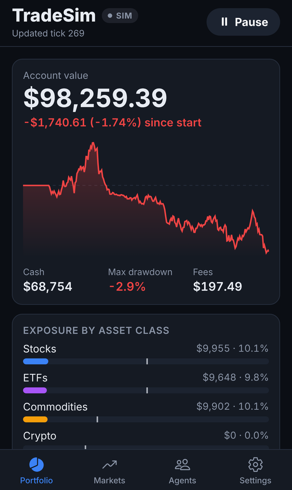
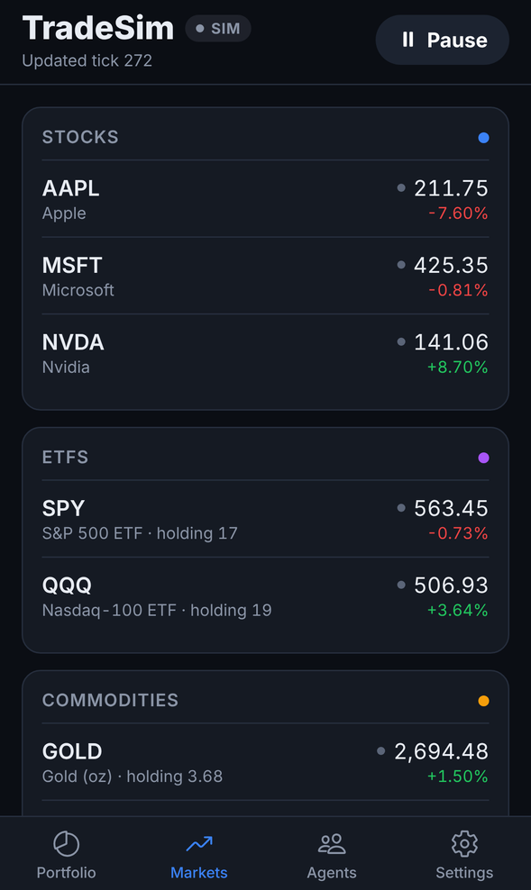
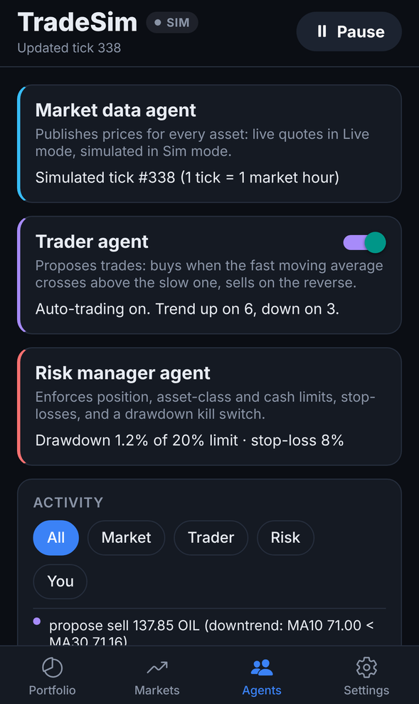

# TradeSim for iPhone

A live paper-trading app for **stocks, ETFs, commodities and crypto**, run by
three agents on your phone. No real money and no broker account. Built with
Expo (React Native), so it also runs on Android.

| Portfolio | Markets | Agents |
|---|---|---|
|  |  |  |

(Screenshots are from Simulated mode; Live mode shows a green **LIVE** badge and real prices.)

## The three agents

| Agent | Role |
|-------|------|
| **Market data** | Fetches a price for every asset on each update. **Live** mode: real quotes, Coinbase for crypto and Yahoo Finance for the rest, straight from the phone, no API keys. A failed quote keeps the last real price, marked stale (amber); nothing is ever made up. **Simulated** mode: generated prices, fast-forwarded (1 tick = 1 market hour). |
| **Trader** | Proposes trades with a moving-average trend strategy: buys ~10% of the account when MA10 rises above MA30, sells when it falls back below. Can be switched off on the Agents tab. It only manages positions it opened: once you trade an asset by hand, it's yours. |
| **Risk manager** | Checks every order, the trader's and yours. Shrinks or refuses buys that break a limit (20% in one asset; stocks 50%, ETFs 50%, commodities 30%, crypto 25%; 5% cash buffer); never blocks a sell. On its own it sells any position down 8% (stop-loss, then a 20-tick buy cooldown) and, at a 20% drawdown, sells everything and halts buying (kill switch). |

Assets: AAPL, MSFT, NVDA, SPY, QQQ, gold, WTI oil, BTC, ETH. Fills include
slippage and fees per asset class. Limits, cash, assets and update speed are in
Settings. Your account is saved on the phone between launches.

## Run it on your iPhone (free, about 5 minutes)

You need a computer (Windows, Mac or Linux) with [Node.js](https://nodejs.org) 20 or newer,
and the free **Expo Go** app from the App Store on your iPhone.

```bash
cd trading-app
npm install
npx expo start
```

A QR code appears in the terminal. Open the iPhone **Camera**, point it at the
QR code, and tap the banner: the app opens in Expo Go. Phone and computer must
be on the same Wi-Fi; if they aren't (or it won't connect), use
`npx expo start --tunnel`.

The computer only delivers the app. Prices come straight from the internet to
your phone, and the agents run on the phone.

## Install it as a standalone app

To get TradeSim on your home screen without Expo Go, build it with
[EAS](https://docs.expo.dev/build/introduction/). This needs an
[Apple Developer account](https://developer.apple.com/programs/) ($99/year);
no Mac is required.

1. In `app.json`, change `com.example.tradesim` to your own id, e.g. `com.yourname.tradesim`.
2. `npx eas-cli@latest login`, then `npx eas-cli@latest build:configure`.
3. `npx eas-cli@latest build --platform ios` and follow the prompts (EAS manages certificates).
4. `npx eas-cli@latest submit --platform ios` to send it to TestFlight, then install it from the TestFlight app.

## Things to know

- **The app trades only while it's open on screen.** iOS pauses apps in the
  background; it picks up again when you return.
- Live quotes: Yahoo's endpoint is unofficial and can rate-limit or change; some
  quotes are delayed up to ~15 minutes. Stocks, ETFs, gold and oil move only in
  their trading hours; crypto trades 24/7. At start-up the app loads the last 30
  one-minute bars so the trader can act straight away.
- The bundled strategy is a simple example and loses money to fees in sideways
  markets. Paper trading only, not investment advice.

## Development

```bash
npm test            # engine tests (agents, broker, live feed with a fake network)
npm run typecheck
```

Code: `src/engine/` is the trading engine and agents (plain TypeScript, no UI);
`src/ui/` is the app; `App.tsx` is the shell. The Python version in
`../trading-sim/` has the same agents as a command-line tool.
